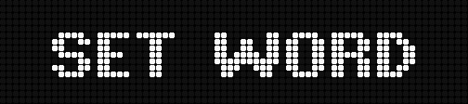
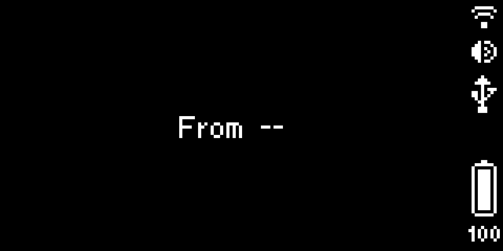
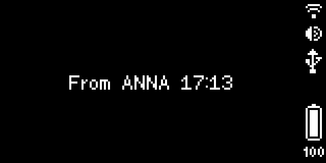
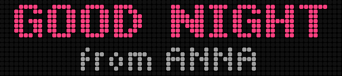
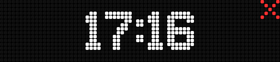
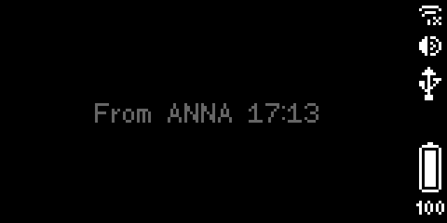

# Bar Link

Send hearts and little messages between two BUSY Bars.


Two bars with the same secret word in their settings are linked. Pick a picture with the wheel and press Start, and within about 10 seconds the other bar plays it with your name, a sound and a blink of the status light. Between messages each bar shows the clock.

A JavaScript app for [BUSY Bar](https://busy.app).

## What the bar shows

Without a secret word in the settings the front display says SET WORD, and the app does nothing else.



With a word set, the front display shows the bar's local time.


The back display shows who sent the last message and when; before the first one it shows `From --`.



Turning the wheel opens the picker and steps through six pictures, each with its word: a heart, lips for a kiss, a phone for CALL ME, a house for HOME, a sad face for MISS YOU and a waving hand. Start sends the picture on the display. Five seconds after the last turn the clock comes back; Start on the clock opens the picker again on the last picture picked, and a second Start sends it.


A message from the other bar takes the front display for 10 seconds, its picture moving beside "from" and the sender's name, with a sound and a pink blink of the status light. The heart beats:


The lips blow a little heart:


The phone rings:


Smoke rises from the chimney:


A tear runs down the sad face:


The hand waves:


The back display then shows the sender and the time the message was sent, and keeps it after a restart.



A message this version of the app has no picture for, sent by another version, shows as its text in pink with the sender's name under it.



When a request to ntfy.sh fails, a red cross shows in the top right corner of the front display and the back display dims, until a request goes through.





The BUSY Bar runs one app at a time, so messages arrive only while this app is open. When it opens, it shows the newest message from the other bar of the last 10 minutes that it has not shown before.

## Buttons

| Button | What it does |
| --- | --- |
| Wheel | Opens the picker and steps through the pictures. |
| Start | In the picker, sends the picture on the display. On the clock, opens the picker on the last picture picked. |
| Back | Quits the app. |

## Settings

| Setting | What it does |
| --- | --- |
| Secret word | The same word on both bars links them. Latin letters and digits. Empty by default. |
| My name | Shown on the other bar with your messages. Latin letters, up to 8. ME by default. |

The app reads its settings when it starts.

## Data

[ntfy.sh](https://ntfy.sh): the two bars post to and read the topic `busybar-` followed by the secret word. The app asks for new messages every 10 seconds; when several came in between, it shows the newest. Topics on ntfy.sh are public, so anyone who knows the word can read and send messages; pick one that is hard to guess. On the BUSY Bar the app keeps the last message received, for the back display, and the ids of its own last 20 messages, to tell them from the other bar's.

## Build

Node 24 and npm:

```sh
npm ci
npm run build         # dist/io.github.vvzvlad.barlink.tgz
npm run app:install   # install it on a BUSY Bar connected over USB
npm run app:run       # start it
```

## License

[MIT](LICENSE)
